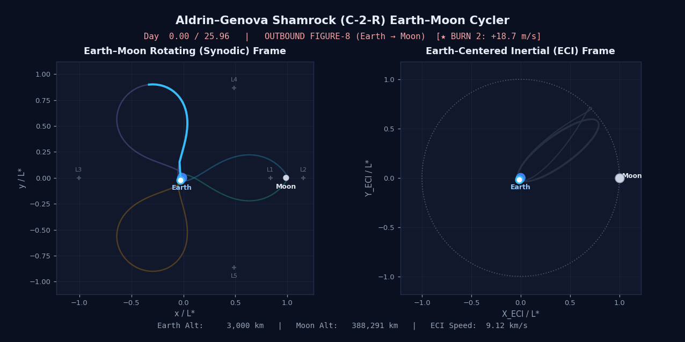
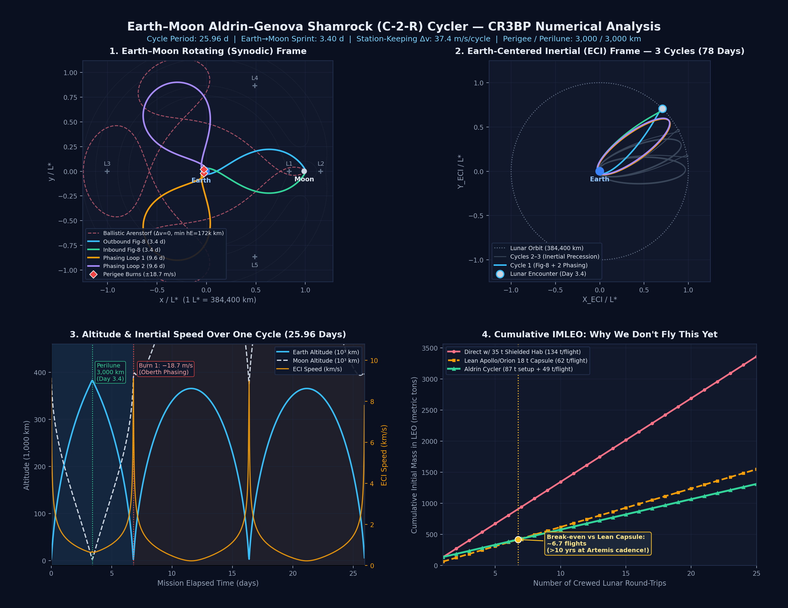
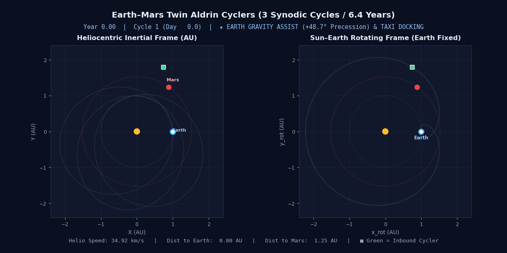
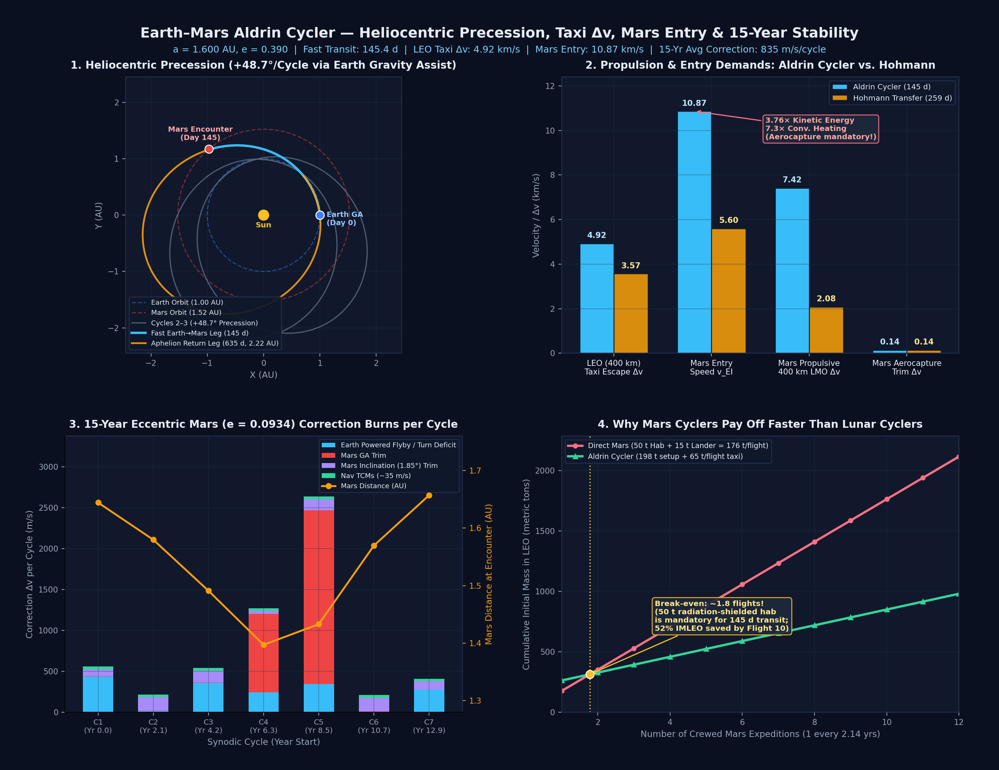

# Aldrin-Cycler — Earth–Moon Cycler Astrodynamics & Simulation

A numerical astrodynamics simulation, interactive animation, and systems-engineering trade study of an **Earth–Moon Aldrin–Genova "Shamrock" (C-2-R) Cycler** solved from first principles in the planar **Circular Restricted Three-Body Problem (CR3BP)**, benchmarked against a **purely ballistic Arenstorf 3-lobe periodic orbit** and direct lunar transport architectures.



---

## What Is an Earth–Moon Aldrin Cycler?

Originally conceptualized by Buzz Aldrin (1985) and realized in high-fidelity cislunar dynamics by Anthony Genova & Buzz Aldrin (AAS 15-794, 2015), a **lunar cycler** is a permanent, heavily shielded "deep-space bus" locked into a repeating trajectory that shuttles perpetually between close Earth perigees and close lunar perilunes. Rather than accelerating and braking an entire radiation-shielded crew habitat on every mission, small crew "taxis" rendezvous with the cycler near Earth, ride inside the heavy habitat for the ~3.4-day cislunar transit, and detach near the Moon to capture into lunar orbit.

---

## Numerical Analysis & Plots



### Computed Orbital Parameters (Earth–Moon CR3BP, $\mu = 0.0121505842$)

| Metric | Aldrin–Genova Shamrock (C-2-R) | Pure Ballistic Arenstorf (3-Lobe) |
| :--- | :---: | :---: |
| **Cycle Period** | **25.958 days** (0.951 lunar mo) | 74.110 days (2.716 lunar mo) |
| **Earth → Moon Transit** | **3.402 days** (6.804 d figure-8 leg) | ~12+ days (no close Earth pass) |
| **Sub-Lunar Phasing Loops** | 2 × 9.577 days (apogee 365,559 km) | None (3 symmetric ballistic lobes) |
| **Earth Perigee Altitude** | **3,000 km** (mid-perigee 2,090 km) | **171,635 km** (misses Earth widely) |
| **Lunar Perilune Altitude** | **3,000 km** ($v_\infty = 0.912\text{ km/s}$) | 627 km |
| **Deterministic Station-Keeping $\Delta v$** | **37.44 m/s/cycle** ($2 \times 18.72\text{ m/s}$) | **0.00 m/s** |
| **Jacobi Constant $C_J$** | 2.1181 (Fig-8) / 2.4424 (Phasing) | 2.8557 (drift $< 7 \times 10^{-12}$) |
| **Floquet Stability / Closure Error** | Closure $6.5 \times 10^{-8}$ | Stability index $\nu = 146.9$ (unstable) |

---

## Mathematical Formulation

In the barycentric rotating (synodic) frame with characteristic length $L^* = 384,400\text{ km}$, time $T^* = 4.3425\text{ days}$, and velocity $V^* = 1.0245\text{ km/s}$:

$$\ddot{x} - 2\dot{y} = \frac{\partial \Omega}{\partial x}, \qquad \ddot{y} + 2\dot{x} = \frac{\partial \Omega}{\partial y}$$

$$\Omega(x, y) = \frac{1}{2}(x^2 + y^2) + \frac{1-\mu}{r_1} + \frac{\mu}{r_2}, \qquad C_J = 2\Omega(x, y) - (\dot{x}^2 + \dot{y}^2)$$

- **Oberth Leverage at Earth Perigee:** Because the cycler whips through Earth perigee at **$v_{\text{ECI}} = 9.125\text{ km/s}$**, a tiny **$-18.72\text{ m/s}$** retrograde tangential burn shifts $C_J$ by $+\Delta(2v\Delta v) \approx +0.324$, dropping apogee from lunar-crossing down to a clean **365,559 km** sub-lunar phasing ellipse. After two symmetric 9.58-day phasing loops, a matching **$+18.72\text{ m/s}$** prograde burn re-injects the cycler onto the exact circumlunar figure-8.
- **Taxi $\Delta v$ & Tsiolkovsky Trade Study:**
  - Earth Taxi (400 km LEO → 3,000 km cycler perigee): **$3.747\text{ km/s}$** (vs. **$3.082\text{ km/s}$** direct TLI — a **+665 m/s Oberth penalty** from matching at 3,000 km altitude).
  - Lunar Taxi (cycler $v_\infty = 0.912\text{ km/s}$ ↔ 100 km LLO): **$0.850\text{ km/s}$** each way.
  - Cumulative IMLEO ($I_{\text{sp}} = 420\text{ s}$ Earth stage / $360\text{ s}$ in-space):
    - **Cycler (35 t shielded hab) + 10 t Taxi:** `86.9 t` setup + `48.9 t/flight` (including only `0.37 t/cycle` station-keeping propellant).
    - **Direct Heavy Transit (35 t hab + 10 t capsule):** `134.4 t/flight` → breaks even at **~1.0 flight** (`60.4%` savings over 20 flights).
    - **Lean Orion/Apollo-Class Direct Capsule (18 t dry):** `61.8 t/flight` → breaks even at **~6.8 flights** (only `13.8%` savings even after 20 flights).

---

## Abilities, Constraints & Why We Aren't Doing This Already

### Abilities
1. **Amortized Heavy Infrastructure:** Radiation storm shelters, closed-loop ECLSS, medical bays, and artificial gravity modules are launched *once* and reused indefinitely for only **~37.4 m/s** (~1% propellant mass fraction) per month.
2. **Built-in Free-Return Safety:** The 6.8-day circumlunar leg is a true ballistic free-return trajectory—if propulsion fails on the outbound sprint, gravity automatically brings the vehicle back to Earth perigee in ~3.4 days.
3. **Predictable Monthly Cadence:** Every **~26 days**, a fast 3.4-day Earth↔Moon transit window opens automatically.

### Engineering Constraints
1. **No Purely Ballistic Free Lunch:** As shown by the Arenstorf comparison, strictly $\Delta v = 0$ CR3BP resonant orbits fail to pair low Earth perigees with close lunar passes and exhibit chaotic instability ($\nu \approx 147$, amplifying tiny errors by ~294× per cycle). Real-world solar gravity and lunar eccentricity ($e = 0.0549$) require continual trajectory correction.
2. **The High-Energy Taxi Problem:** A cycler does *not* eliminate propulsion—it only moves the heavy habitat off the taxi's manifest. The crew taxi still pays **~3.75 km/s** at Earth and **~0.85 km/s** at the Moon, and must execute a precision **hyperbolic / high-speed rendezvous** with zero margin for a missed docking window.
3. **Repeated Van Allen Belt Crossings:** Passing through 2,000–3,000 km Earth perigee three times every 26 days (~42 crossings/year) exposes solar arrays and avionics to heavy inner Van Allen trapped-proton degradation.

### Why We Aren't Doing This Already
1. **The Moon Is Only 3.4 Days Away:** Unlike Earth–Mars (where a 6-month transit *forces* a heavy 35–60 t deep-space habitat), astronauts can tolerate a 3.4-day cislunar flight inside a compact **18 t Orion/Apollo capsule**. Against a lean direct capsule, our simulation shows the cycler needs **~7+ crewed missions** just to break even on mass in LEO—and at current Artemis cadence (~1 crewed mission every 1–2 years), that's a **decade+** before mass savings even begin, while paying billions upfront today.
2. **Rigid Schedule & Unforgiving Abort Modes:** If a taxi has a launch scrub or docking abort during the narrow perigee window, the cycler screams past Earth at **9.1 km/s** and won't return to a lunar-bound window for **26 days**.
3. **Lunar Gateway in NRHO Fits Low-Cadence Exploration Better:** NASA opted for a stationary depot in a **Near-Rectilinear Halo Orbit (NRHO)** around the Moon because it serves as a persistent lunar staging node without requiring high-speed perigee/perilune docking races or repeated Van Allen crossings.
4. **Fully Reusable Super-Heavy Launchers Shift the Economics:** With vehicles like Starship targeting low-cost orbital refueling, launching a comfortable direct spacecraft becomes operationally simpler than maintaining a separate permanent cycling station—until cislunar traffic reaches a steady **monthly commuter cadence** (dozens of crewed flights per year).

---

## Earth–Mars Aldrin Cycler (1-Synodic Twin Escalator Architecture)





Buzz Aldrin's original 1985 Earth–Mars cycler (`a = 1.600 AU`, `e = 0.3904`, `T_orb = 2.023 yr`) uses an Earth gravity assist every synodic period (`779.95 d`) to precess its line of apsides by **+48.72°**, delivering a fast **145.4-day** Earth → Mars transfer (with a mirror-symmetric Inbound "Down-Escalator" cycler for 145.4-day Mars → Earth returns).

| Parameter | Aldrin Cycler (145 d) | Minimum-Energy Hohmann (259 d) |
| :--- | :---: | :---: |
| **Earth $v_{\infty, E}$** | **6.40 km/s** | 2.95 km/s |
| **Taxi $\Delta v$ from 400 km LEO** | **4.92 km/s** ideal (~5.12 km/s ops) | 3.57 km/s |
| **Mars $v_{\infty, M}$** | **9.68 km/s** | 2.65 km/s |
| **Mars Entry Interface ($125\text{ km}$)** | **10.87 km/s** (3.76× KE, 7.3× conv. heating) | 5.60 km/s |
| **Mars Propulsive Capture (400 km LMO)** | **7.42 km/s** (impractical chemically) | 2.08 km/s |
| **Mars Aerocapture Trim $\Delta v$** | **~0.14 km/s** (mandatory) | ~0.14 km/s |
| **15-Yr Eccentric Mars Correction Burns** | **avg 835 m/s/cycle** (211–2,638 m/s across 7 oppositions) | N/A |
| **B-Plane Flyby Sensitivity** | **1 km Earth error → 3,901 km Mars / 111,569 km Earth miss** | N/A |

---

## Repository Structure

```text
Aldrin-Cycler/
├── src/
│   ├── cr3bp.py             # Planar Earth-Moon CR3BP ODEs, STM, Lagrange points, differential corrector
│   ├── cycler_solver.py     # Earth-Moon Shamrock (C-2-R) & Arenstorf solvers + Tsiolkovsky trade study
│   ├── mars_cycler.py       # Earth-Mars Aldrin Cycler, 15-yr eccentric Lambert optimizer, aerocapture & stability
│   ├── visualize.py         # Earth-Moon 4-panel PNG & dual-frame animated GIF
│   ├── visualize_mars.py    # Earth-Mars 4-panel PNG & dual-frame animated GIF
│   ├── build_web.py         # Compiles interactive Earth-Moon HTML5 simulator (web/index.html)
│   └── build_mars_web.py    # Compiles interactive Earth-Mars HTML5 simulator (web/mars.html)
├── data/
│   ├── cycler_solution.json
│   └── mars_cycler_solution.json
├── assets/
│   ├── aldrin_cycler_animation.gif
│   ├── cycler_analysis.png
│   ├── mars_cycler_animation.gif
│   └── mars_cycler_analysis.png
├── web/
│   ├── index.html           # Interactive Earth-Moon simulator
│   └── mars.html            # Interactive Earth-Mars simulator
├── tests/
│   └── test_cr3bp.py        # Pytest numerical physics verification suite (Moon + Mars)
└── requirements.txt
```

## Quickstart

```bash
pip install -r requirements.txt

# Earth-Moon Cycler
python src/cycler_solver.py && python src/visualize.py && python src/build_web.py

# Earth-Mars Cycler
python src/mars_cycler.py && python src/visualize_mars.py && python src/build_mars_web.py

# Run all numerical physics verification tests
python -m pytest -v
```
